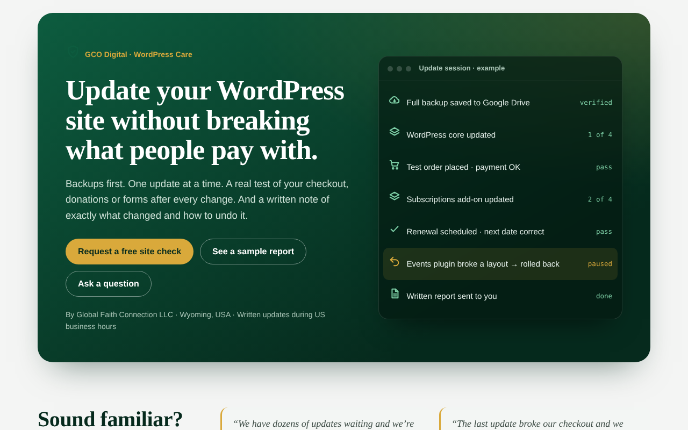
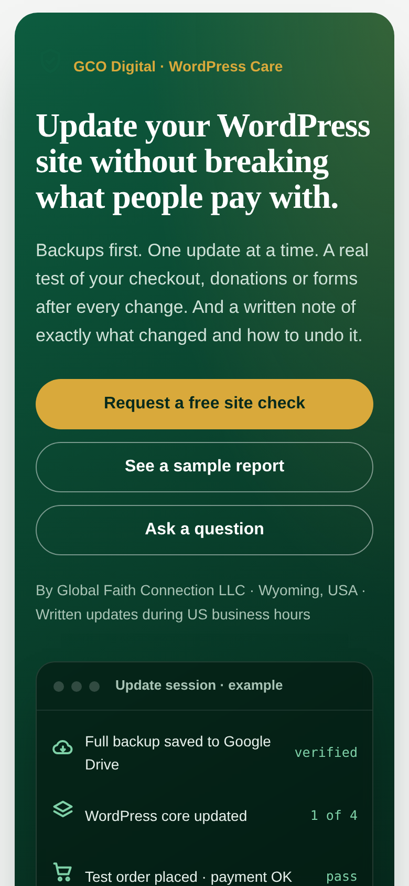
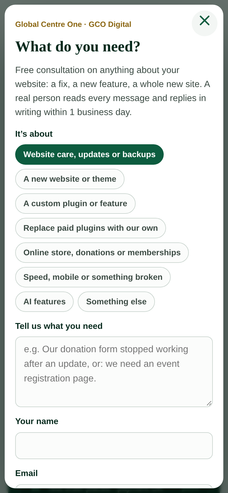
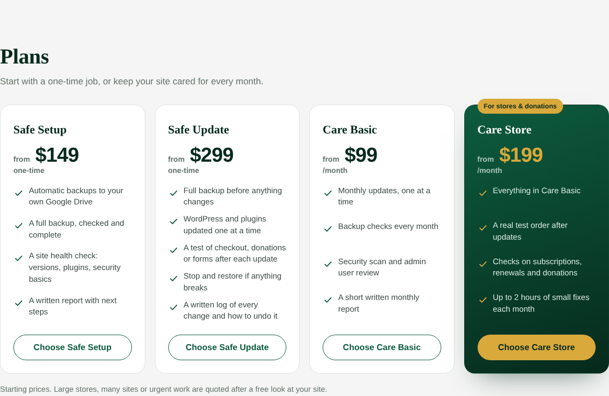
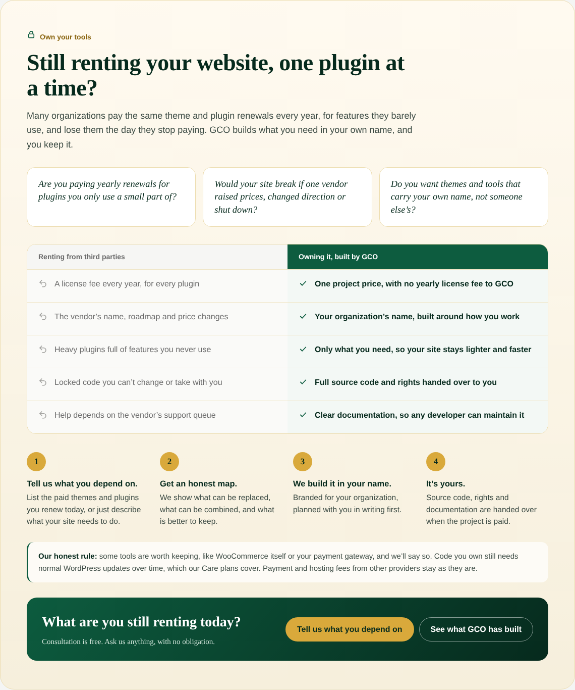
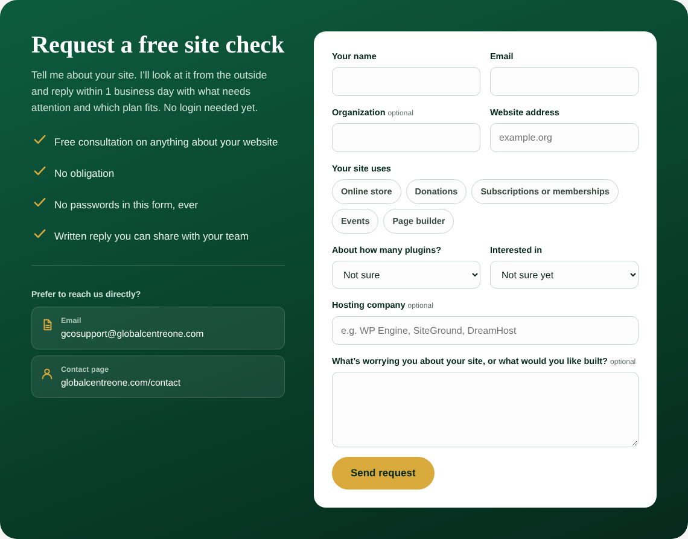

# GCO WordPress Care

A WordPress plugin that adds a complete **WordPress care & security service page** to a site, plus an **"Ask GCO" request banner** on every page. Requests are saved in the WordPress dashboard and emailed to the site owner, with a reply box built in.

Built and used on [globalcentreone.com](https://globalcentreone.com/wordpress-care/) by Global Faith Connection LLC.



## Features

- **Service page with one shortcode:** `[gco_care]` renders the hero, common problems, how the work is done, a sample report, portfolio, plans, other services, an "Own your tools" section, FAQ and a request form.
- **Page created on activation:** a "WordPress Care & Security" page with the shortcode is created for you.
- **Ask GCO banner on every page:** a quiet banner above the theme footer that opens a short request dialog. It can also be a floating button, or turned off.
- **Requests saved in the dashboard:** every message is stored under *Care Requests* with status, site, plan and contact details. Nothing is lost if email fails.
- **Reply from WordPress:** a reply box on each request sends the answer by email and keeps a history.
- **Emails both ways:** the site owner gets a notification with Reply-To set to the sender, and the sender gets a confirmation.
- **Works with page caching:** no nonce on the public form, so cached pages still submit. Spam is handled with a honeypot field, a time check and a rate limit (3 per 10 minutes). Suspicious messages are saved as "Check", never silently dropped.
- **Form drafts kept:** if a submission fails validation, what the visitor typed is restored.
- **Settings screen:** email, company, plans, services, portfolio, banner text, button style and brand colors under *Settings → GCO WordPress Care*.
- **Structured data:** JSON-LD for the service and the FAQ.
- **Accessible and mobile-safe:** keyboard focus styles, reduced-motion support, native `<dialog>`, and layouts tested from 240px to 412px wide with no horizontal scrolling.
- **No third-party services or paid add-ons.**

## Screenshots

| Mobile | Ask GCO dialog |
|---|---|
|  |  |

Plans



"Own your tools" section



Request form



Banner shown on every page


## Requirements

- WordPress 6.0 or newer
- PHP 7.4 or newer
- Working outgoing email (an SMTP plugin is recommended)

## Installation

1. Download this repository as a ZIP (**Code → Download ZIP**).
2. In WordPress, go to **Plugins → Add New → Upload Plugin** and upload the ZIP.
3. Activate **GCO WordPress Care**.
4. Open **Settings → GCO WordPress Care** to set your email, plans and colors.
5. Visit the new **WordPress Care & Security** page.

## File structure

```
gco-wp-care.php        Plugin bootstrap and activation
includes/settings.php  Settings screen and option helpers
includes/render.php    [gco_care] shortcode output and JSON-LD
includes/requests.php  Care Requests post type, form handler, emails, replies
includes/ask.php       Ask GCO banner and dialog on every page
assets/care.css        Styles, scoped to the plugin
assets/care.js         Dialog, drafts, banner placement
```

## License

GPL-2.0-or-later. See [LICENSE](LICENSE).

## Author

**Jansen Great** · [jansengreat.globalcentreone.com](https://jansengreat.globalcentreone.com) · Global Faith Connection LLC, Wyoming, USA
